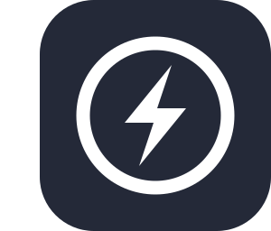

<!-- ═══════════════════════════════════  HERO  ═══════════════════════════════════ -->

  
  
  

<!-- ═══════════════════════════════════  ABOUT  ═══════════════════════════════════ -->
<h2 align="center">👋 Hi, I’m Dipak Kumar</h2>

  I’m a <b>B.Tech CSE (Cybersecurity)</b> student at <b>Bennett University</b>, India, building practical software with a focus on
  <b>AI agents, cybersecurity, blockchain, and product engineering</b>.

  I like turning ideas into real systems that people can actually use — from healthcare platforms and cybersecurity
  learning products to agent-based automation and business software.

  

<!-- ═══════════════════════════════════  PROJECTS  ═══════════════════════════════════ -->
<h2 align="center">🚀 What I’m Building</h2>

Click a card to open the project · live projects open their site

<!-- TODO: when a project goes live, replace its https://github.com/DipakThakur13 link with the demo URL -->

  
  
  
  
  
  
  

 

<b>📋 Project details (text version)</b>

 

| Project | What it is | Link |
| :-- | :-- | :-- |
| 🛡️ **Aegis** | AI-powered agent ecosystem for news intelligence, coding assistance, trading strategy support, and intelligent workflow automation. | _Live demo coming soon_ |
| 🤖 **COMU** | Multi-modal AI coding agent, built on BYOK (Bring Your Own Key). | _In active development_ |
| 🩺 **MedNexus** | Next-generation healthcare / EHR platform featuring blockchain-powered identity management, patient consent flow, electronic health records, and secure medical data sharing. | [mednexus.boswas.co.in](https://mednexus.boswas.co.in) |
| 🔐 **CyberLab** | Interactive cybersecurity learning and article platform offering practical labs, penetration testing guides, and hands-on security education. | [cyberlab.boswas.co.in](https://cyberlab.boswas.co.in) |
| 🛒 **Boswas Store** | Enterprise SaaS marketplace and customer portal where organizations can purchase software licenses, manage subscriptions, access invoices, download products, and request custom software development services through a modern business dashboard. | _Live demo coming soon_ |
| 🏢 **Boswas Group** | Multi-company ecosystem and corporate website showcasing its companies, products, innovations, and long-term vision across technology, healthcare, AI, and enterprise solutions. | [www.boswas.co.in](https://www.boswas.co.in) |
| ⛓️ **Blockchain Projects** | Collection of decentralized applications and smart contracts built using Solidity, Hardhat, OpenZeppelin Upgradeable Contracts (UUPS), and modern Web3 architecture. | _Showcase coming soon_ |

> 🧱 Also building smart contract and backend systems with **Solidity, NestJS, Node.js, MongoDB, and TypeScript**.

<!-- ═══════════════════════════════════  FOCUS  ═══════════════════════════════════ -->
<table>
<tr>
<td width="50%" valign="top">

### 🎯 Current Focus

- 🤖 Building **production-ready AI agents**
- 🏗️ Improving **backend architecture & system design**
- 📈 Learning **trading automation & financial reasoning**
- 🛡️ Strengthening **cybersecurity & blockchain** development
- 🚢 Shipping real-world products with **clean UI & strong UX**

</td>
<td width="50%" valign="top">

### 🧠 What I Care About

- 🧩 Building **useful products**
- ✨ Writing **clean and scalable code**
- 🎯 Solving **real problems** with technology
- ⚡ **High-performance** systems
- 🔐 **AI, security, finance, and automation**

</td>
</tr>
</table>

### ⚡ Highlights

- 🛡️ Cybersecurity student with a strong **product-building mindset**
- 🌐 Working across **frontend, backend, blockchain, and AI systems**
- 💹 Interested in **financial systems, automation, and intelligent agents**
- 🚀 Focused on making projects **deployment-ready and business-friendly**

<!-- ═══════════════════════════════════  TECH STACK  ═══════════════════════════════════ -->
<h2 align="center">🛠️ Tech Stack</h2>

<table align="center">
  <tr>
    <td align="center" width="170"><b>💻 Languages</b></td>
    <td></td>
  </tr>
  <tr>
    <td align="center"><b>🎨 Frontend</b></td>
    <td></td>
  </tr>
  <tr>
    <td align="center"><b>⚙️ Backend</b></td>
    <td></td>
  </tr>
  <tr>
    <td align="center"><b>🗄️ Databases & Tools</b></td>
    <td></td>
  </tr>
</table>

<!-- ═══════════════════════════════════  ANALYTICS  ═══════════════════════════════════ -->
<h2 align="center">📊 GitHub Analytics</h2>

  
  

 

  

 

  

<!-- ═══════════════════════════════════  CONNECT  ═══════════════════════════════════ -->
<h2 align="center">🌍 Connect With Me</h2>

  
  
  
  
  

 

<!-- ═══════════════════════════════════  OUTRO  ═══════════════════════════════════ -->
<h3 align="center">✨ A little about me</h3>

I believe in building with discipline, learning fast, and shipping things that matter.

<i>“Dream big, build real, and keep improving.”</i>

  

